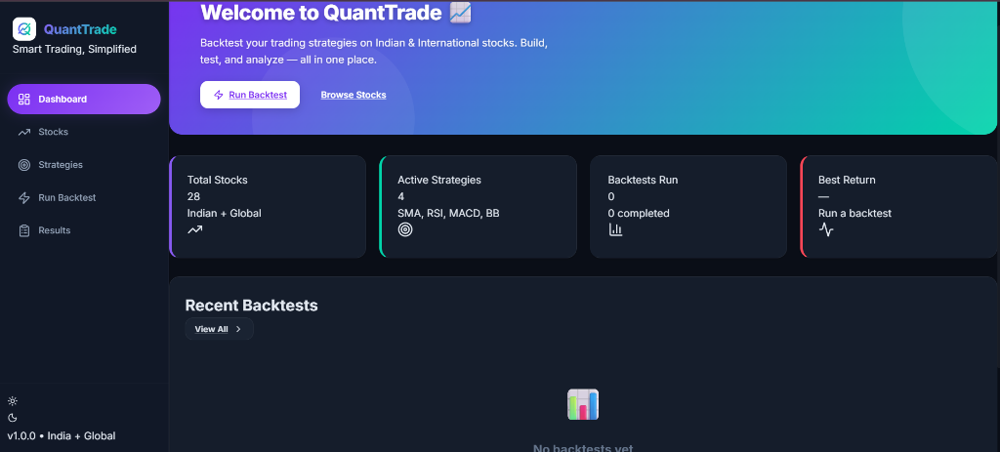

# 📈 QuantTrade — Quantitative Strategy Backtesting Platform

> Smart Trading, Simplified. Backtest algorithmic trading strategies on Indian (NSE/BSE) and international equities with institutional-grade performance analytics, equity curves, and risk metrics.

[](https://quanttrade-frontend.vercel.app/)
[](https://react.dev/)
[](https://www.typescriptlang.org/)
[](https://vitejs.dev/)
[](https://recharts.org/)
[](https://github.com/kumarrishi4981/quanttrade-backend)
[](LICENSE)

---

### 🌐 Live Application
👉 **Launch QuantTrade Live:** [https://quanttrade-frontend.vercel.app/](https://quanttrade-frontend.vercel.app/)

---



---

## 📌 Overview

**QuantTrade** is a high-performance quantitative analysis platform that democratizes backtesting for retail traders and quantitative researchers. It empowers users to simulate trading rules against historical market data without writing boilerplate code.

Users can choose from a curated universe of **28 Indian (NSE/BSE) and global assets**, configure strategy parameters, execute historical simulations, and immediately visualize trade executions, drawdowns, and portfolio growth.

---

## ✨ Key Features

- **📊 Multi-Market Asset Universe**:
  - Live exploration of 28+ leading equities across Indian (NIFTY / SENSEX) and international markets.
  - Interactive price charts, historical candles, and asset details.
- **🎯 4 Quantitative Strategies Pre-Built**:
  - **SMA Crossover**: Trend-following algorithm using dual moving average crossovers.
  - **RSI Mean Reversion**: Momentum strategy identifying overbought ($\ge 70$) and oversold ($\le 30$) conditions.
  - **MACD Momentum**: Signal line crossovers combining momentum and trend direction.
  - **Bollinger Bands (BB)**: Volatility breakout and mean-reversion trading rules.
- **⚡ Instant Backtest Engine**:
  - Configurable initial capital, date ranges, and strategy-specific hyper-parameters.
- **📈 Advanced Performance Metrics & Equity Curves**:
  - Visualized portfolio equity curves powered by **Recharts**.
  - Key risk metrics: **Total Return %**, **CAGR**, **Max Drawdown (MDD)**, **Win Rate**, and **Sharpe Ratio**.
- **📜 Detailed Trade Audit Logs**:
  - Full trade-by-trade breakdown (entry date/price, exit date/price, P&L, hold duration).
- **🌓 Theme & System Status**:
  - Dark/Light mode operational toggle with integrated backend health banner (`ServerStatusBanner.jsx`).

---

## 🛠️ Tech Stack & Architecture

```text
┌─────────────────────────────────┐               HTTP REST               ┌─────────────────────────────────┐
│     QuantTrade Frontend         │ <===================================> │      QuantTrade Backend         │
│  (React 18, Vite, Recharts)     │        (Market Data & Backtests)      │     (Spring Boot / Java)        │
└─────────────────────────────────┘                                       └─────────────────────────────────┘
```

| Layer | Technology |
| :--- | :--- |
| **Framework** | React 18, Vite, TypeScript |
| **Routing** | React Router DOM v7 |
| **Data Visualization** | Recharts (Responsive Line & Candlestick charts) |
| **Icons & UI** | Lucide React, Custom Dark Theme CSS |
| **API Client** | Native Fetch / REST Service (`src/services/api.js`) |
| **Hosting** | Vercel (Edge Network) |
| **Companion Backend** | [QuantTrade Backend (Java / Spring Boot)](https://github.com/kumarrishi4981/quanttrade-backend) |

---

## 📂 Project Structure

```text
quanttrade-frontend/
├── src/
│   ├── components/              # Sidebar, ServerStatusBanner, reusable widgets
│   ├── pages/                   # Application route pages
│   │   ├── Dashboard.jsx        # Market stats, quick launchers, KPIs
│   │   ├── Stocks.jsx           # Stock browser & ticker directory
│   │   ├── StockDetail.jsx      # Historical chart & asset fundamentals
│   │   ├── Strategies.jsx       # Strategy library (SMA, RSI, MACD, BB)
│   │   ├── RunBacktest.jsx      # Simulation parameter configuration
│   │   ├── Results.jsx          # Historical backtest runs & comparisons
│   │   └── BacktestDetail.jsx   # Equity curve graphs & trade logs
│   ├── services/
│   │   └── api.js               # Backend API connection layer
│   ├── App.jsx                  # Main router & layout provider
│   └── style.css                # Custom theme styling & animations
├── public/                      # Static branding assets
├── vercel.json                  # SPA routing configuration for Vercel
├── package.json
└── README.md                    # Documentation
```

---

## 🚀 Local Development Setup

### Prerequisites
- **Node.js** (v18+) and **npm**
- Running instance of the [QuantTrade Backend](https://github.com/kumarrishi4981/quanttrade-backend) (optional for local mock data)

---

### 1. Clone the Repository
```bash
git clone https://github.com/kumarrishi4981/quanttrade-frontend.git
cd quanttrade-frontend
```

### 2. Install Dependencies
```bash
npm install
```

### 3. Environment Configuration
Create a `.env` file in the root directory:
```env
VITE_API_URL=http://localhost:8080
```

### 4. Run Development Server
```bash
npm run dev
```
* Open your browser at `http://localhost:5173`.

---

## ☁️ Deployment (Vercel)

The repository includes a pre-configured `vercel.json` rewrite configuration for single-page React applications:

1. Import the repository into **[Vercel](https://vercel.com/)**.
2. Add your backend URL to **Environment Variables**:
   - `VITE_API_URL` = `<your_backend_url>`
3. Click **Deploy**.

---

## 🤝 Contributing
Contributions and algorithmic strategy ideas are welcome!
1. Fork the Project
2. Create your Feature Branch (`git checkout -b feature/SupertrendStrategy`)
3. Commit your Changes (`git commit -m 'feat: Add Supertrend indicator'`)
4. Push to the Branch (`git push origin feature/SupertrendStrategy`)
5. Open a Pull Request

---

## 📄 License
This project is open-source under the **MIT License**.

---

## 👤 Author
- **Rishi Kumar**
- GitHub: [@kumarrishi4981](https://github.com/kumarrishi4981)
- Live App: [QuantTrade on Vercel](https://quanttrade-frontend.vercel.app/)
